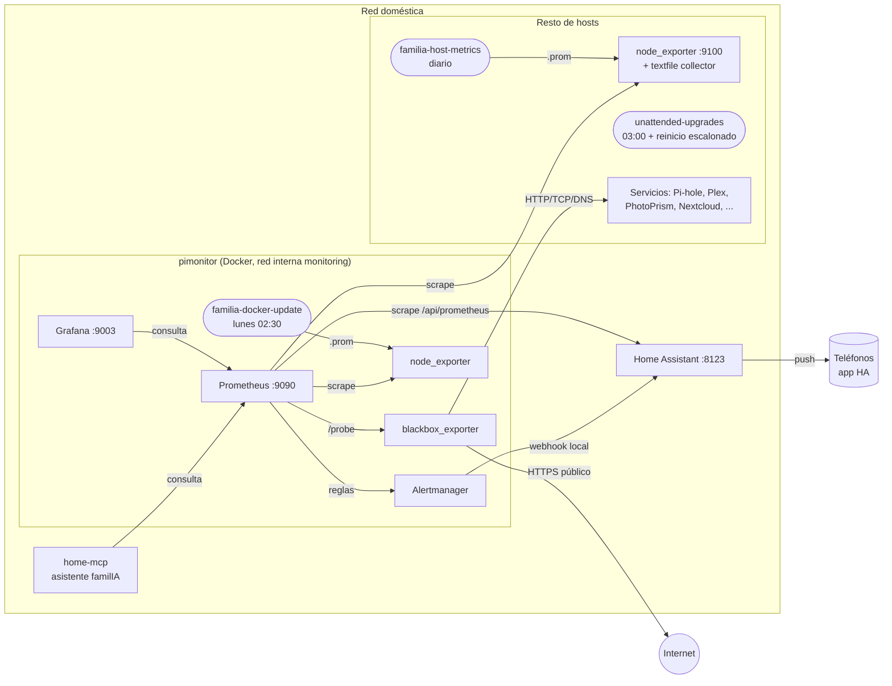

# monitoring

Monitorización de una red doméstica de Raspberry Pi: métricas, mapa de red en Grafana, sondas de servicios,
alertas de temperatura al móvil vía Home Assistant y mantenimiento automático (actualizaciones del sistema e
imágenes Docker con vuelta atrás).

Forma parte del ecosistema [familIA](https://github.com/mahdsip/familIA); el asistente de voz consulta estos datos
a través de [home-mcp](https://github.com/mahdsip/home-mcp).

## Qué hace

| Pieza | Qué aporta |
|---|---|
| **Prometheus** | Recoge métricas de todos los hosts (`node_exporter`), de Home Assistant y de las sondas de servicios. |
| **Grafana** | Dashboard "Casa · red y dispositivos": mapa de red (router → dispositivos → proxy inverso), estado, temperatura, CPU, RAM, discos, hardware·RAM, SO y kernel, actualizaciones pendientes (SO, Docker, apps) y servicios por dispositivo. Generado desde un YAML. |
| **blackbox_exporter** | Sondas en vivo de cada servicio: HTTP, HTTPS en LAN (certificado autofirmado), HTTPS público, TCP y DNS. |
| **Alertmanager → Home Assistant** | Alertas de temperatura (80 °C aviso, 85 °C crítica) como notificación push a teléfonos concretos. |
| **familia-host-metrics** | Colector diario por host: paquetes apt pendientes, reinicio requerido, imágenes Docker con versión nueva, versiones de Pi-hole. Escribe en el *textfile collector* de `node_exporter`. |
| **familia-docker-update** | Cada lunes a las 02:30: `pull` → copia de seguridad → recreación del contenedor → comprobación de salud → vuelta atrás automática si falla. |
| **maintenance/** | Actualizaciones automáticas del sistema (unattended-upgrades) con reinicio escalonado, y scripts puntuales de migración. |

## Diagrama de componentes



Flujo de datos:

1. **Métricas**: Prometheus lee `node_exporter` en cada host. Los colectores propios escriben ficheros `.prom` que
   `node_exporter` publica, así que no abren ningún puerto nuevo.
2. **Servicios**: Prometheus pide a `blackbox_exporter` (`/probe?target=…&module=…`) que pruebe cada servicio. La
   lista de servicios se genera desde `grafana/casa.devices.yml`.
3. **Alertas**: las reglas `prometheus/rules/*.yml` disparan → Alertmanager (red interna, sin puerto publicado) →
   webhook `local_only` de Home Assistant → notificación a teléfonos concretos (no a todos los dispositivos).
4. **Visualización**: Grafana con datasource y dashboard aprovisionados desde el repo (solo lectura en la UI).

## Pila tecnológica

| Capa | Tecnología | Versión probada |
|---|---|---|
| Hardware | Raspberry Pi 2/3/4/5 y mini-PC x86 | pimonitor: Raspberry Pi 4 |
| Sistema | Raspberry Pi OS / Debian 12 (bookworm) y 13 (trixie), Raspbian 32-bit | pimonitor: Debian 12, aarch64 |
| Contenedores | Docker + docker compose (v1 `docker-compose` o plugin v2) | Docker 20.10.24, compose 1.29.2 / v5.6.1 |
| Métricas | Prometheus | 3.16.0 |
| Visualización | Grafana (panel Canvas, transformaciones) | 13.3.0 |
| Alertas | Alertmanager | 0.34.2 |
| Sondas | blackbox_exporter | 0.29.1 |
| Exportador | node_exporter (contenedor o paquete Debian) | 1.12.1 |
| Notificaciones | Home Assistant + app Companion (iOS/Android) | 2026.10 |
| Scripts | Python 3.9+ (solo biblioteca estándar en los hosts), Bash | Python 3.11 / 3.13 |
| Generador de dashboard | Python 3.11+ con PyYAML 6.0.3 (en la máquina de desarrollo) | — |
| Tests | pytest 8.3.5, ejecutado con `uv` | — |
| Mantenimiento SO | unattended-upgrades, systemd timers, `systemd-run` | — |

Las imágenes usan la etiqueta `latest`: el actualizador semanal las mantiene al día y vuelve a la imagen anterior
si la nueva no pasa la comprobación de salud.

## Prerrequisitos

**Host de monitorización** (ej. una Raspberry Pi 4, ≥ 2 GB RAM, ~10 GB libres para el TSDB):

- Docker y docker compose.
- Red Docker externa `monitoring`: `docker network create monitoring`.
- Volúmenes externos: `prometheus-data`, `grafana-data`, `alertmanager-data` (`docker volume create <nombre>`).
- Python 3.9+ (para los colectores y el actualizador).

**Cada host monitorizado**:

- `node_exporter` escuchando en `:9100` (paquete `prometheus-node-exporter` o contenedor) con el *textfile
  collector* activado (lo configura `host-metrics/install.sh`).
- Python 3.9+ para `familia-host-metrics`.
- Para las actualizaciones automáticas: Debian/Raspbian con systemd y `sudo`.

**Home Assistant** (opcional, para alertas al móvil y métricas de actualizaciones de HA):

- Integración Prometheus activada (`prometheus:` en `configuration.yaml`, filtrada a entidades `update.*`).
- Un token de larga duración para Prometheus.
- La app Companion en los teléfonos que recibirán las alertas.

**Máquina de desarrollo**: [`uv`](https://docs.astral.sh/uv/) (para tests y para generar el dashboard), SSH a los hosts.

## Estructura del repositorio

```
docker-compose.yml            Pila de pimonitor (5 servicios, red y volúmenes externos)
prometheus/
  prometheus.example.yml      Plantilla de scrape (copiar a prometheus.yml, gitignored)
  rules/temperatura.yml       Alertas de temperatura
  servicios/                  (generado) objetivos de las sondas, file_sd
alertmanager/alertmanager.yml Ruta única → webhook de Home Assistant (URL en secrets/)
blackbox/blackbox.yml         Módulos de sonda: http_up, http_auth, https_lan, https_public, tcp_open, dns_resolve
grafana/
  build_dashboard.py          Genera dashboards/casa.json y prometheus/servicios/servicios.yml
  casa.devices.example.yml    Plantilla del inventario de la casa
  check_queries.py            Valida las consultas PromQL del dashboard contra un Prometheus real
  provisioning/               Datasource y proveedor de dashboards (solo lectura)
homeassistant/
  alertas_temperatura.yaml    Automatización: webhook → notify.mobile_app_* de dos teléfonos
host-metrics/                 Colector familia-host-metrics + instalador (timer diario)
docker-updates/               Actualizador semanal de imágenes + configs por host
maintenance/
  setup_auto_updates.sh       unattended-upgrades con reinicio escalonado y protección ante desinstalaciones
  survey_updates.sh           Inventario rápido de actualizaciones pendientes de un host
  pidata/, pimonitor/         Scripts puntuales de migración (documentan cómo se hizo)
```

## Instalación

### 1. Pila de monitorización

```bash
git clone https://github.com/mahdsip/monitoring.git && cd monitoring
cp prometheus/prometheus.example.yml prometheus/prometheus.yml        # editar IPs y nombres
cp grafana/casa.devices.example.yml grafana/casa.devices.yml          # inventario de la casa
uv run --no-project --with pyyaml==6.0.3 python grafana/build_dashboard.py

docker network create monitoring
for v in prometheus-data grafana-data alertmanager-data; do docker volume create $v; done
```

Secretos (nunca en el repo, modo 600):

```bash
mkdir -p prometheus/secrets alertmanager/secrets
# Token de larga duración de HA, legible por el usuario del contenedor (nobody = 65534)
install -m 600 -o 65534 /dev/stdin prometheus/secrets/ha_token <<< "<token>"
# URL del webhook de la automatización de HA
install -m 600 -o 65534 /dev/stdin alertmanager/secrets/ha_webhook_url <<< "http://<ha>:8123/api/webhook/<id-aleatorio>"
```

Arranque y comprobación:

```bash
docker compose up -d        # o docker-compose up -d
docker exec prometheus promtool check config /etc/prometheus/prometheus.yml
docker exec prometheus promtool check rules /etc/prometheus/rules/temperatura.yml
docker exec alertmanager amtool check-config /etc/alertmanager/alertmanager.yml
curl -s localhost:9090/-/ready; curl -s localhost:9003/api/health
```

Si ya tienes datos de Prometheus en otro volumen, crea un `.env` junto al compose:
`PROMETHEUS_VOLUME=<nombre-del-volumen>`.

### 2. Alertas al móvil (Home Assistant)

1. Ajustes → Automatizaciones → Crear → ⋮ → Editar en YAML → pega `homeassistant/alertas_temperatura.yaml`.
2. Cambia `CAMBIAR-POR-UN-ID-ALEATORIO` por `openssl rand -hex 16` y pon el mismo id en
   `alertmanager/secrets/ha_webhook_url`.
3. Cambia `notify.mobile_app_telefono_1/2` por los servicios de tus teléfonos.
4. Prueba: `docker exec alertmanager amtool alert add prueba severity=warning instance=test:9100 --annotation=summary=Prueba`.

### 3. Colector en cada host

```bash
scp host-metrics/{familia_host_metrics.py,install.sh} <host>:/tmp/hm/
ssh -t <host> 'sudo bash /tmp/hm/install.sh --textfile-dir /var/lib/node_exporter/textfile_collector --apt [--docker] [--pihole]'
```

Opciones para que `node_exporter` lea el directorio: `--patch-unit node_exporter.service` (binario manual) o
`--recreate-container node-exporter` (contenedor).

### 4. Actualizador semanal de Docker

```bash
scp docker-updates/{familia_docker_update.py,install.sh,pimonitor.json} <host>:/tmp/du/
ssh -t <host> 'sudo bash /tmp/du/install.sh --config pimonitor.json --dry-run'
```

Cada servicio del JSON declara comprobaciones de salud (`http` desde el host o `exec` dentro del contenedor),
`health_timeout` opcional y una copia previa opcional:

- `mariadb-dump`: volcado lógico completo, con rotación; la contraseña se lee del propio contenedor.
- `volume-tar`: para el servicio, archiva su volumen y **lo restaura en la vuelta atrás** (ej. Grafana, cuya
  base de datos migra al actualizar).

Log: `/var/log/familia-docker-update.log`. Métricas: `familia_docker_update_result{container,result}`.

### 5. Actualizaciones automáticas del sistema

```bash
scp maintenance/setup_auto_updates.sh <host>:/tmp/
ssh -t <host> 'sudo bash /tmp/setup_auto_updates.sh --reboot-time 04:30 --apply --reboot-if-needed'
```

Usa una hora de reinicio distinta en cada host. Antes de aplicar, el script simula la actualización y **se niega a
continuar si se desinstalaría algún paquete** que no hayas aprobado con `--allow-removals "pkg ..."`.

## Calendario de mantenimiento

| Hora | Qué |
|---|---|
| Diario ~03:00 | unattended-upgrades en cada host; reinicio solo si hace falta, a la hora de cada host |
| Diario | familia-host-metrics refresca el estado de actualizaciones |
| Lunes 02:30 | familia-docker-update en los hosts con Docker (y refresco inmediato de las métricas) |

## Seguridad

- Ningún componente nuevo publica puertos: Alertmanager y blackbox solo existen en la red Docker interna; los
  colectores escriben ficheros.
- Tokens y URLs de webhook en `*/secrets/` (gitignored, modo 600), referenciados con `credentials_file` /
  `url_file`.
- El webhook de HA es `local_only` y su id es aleatorio.
- El inventario real (`casa.devices.yml`, con nombres públicos) y `prometheus.yml` están fuera del repo.
- Grafana y su datasource se aprovisionan en solo lectura: el repo es la fuente de verdad.

## Desarrollo y tests

```bash
cd grafana        && uv run -q --no-project -p 3.13 --with pytest==8.3.5 --with pyyaml==6.0.3 pytest -q
cd host-metrics   && uv run -q --no-project -p 3.13 --with pytest==8.3.5 pytest -q
cd docker-updates && uv run -q --no-project -p 3.13 --with pytest==8.3.5 pytest -q
```

Generar el dashboard desde la plantilla de ejemplo sin tocar nada:

```bash
uv run --no-project --with pyyaml==6.0.3 python grafana/build_dashboard.py \
  --config grafana/casa.devices.example.yml --dashboard-out /tmp/casa.json --targets-out /tmp/servicios.yml
```

Notas de Grafana aprendidas por el camino: un patrón `byRegexp` sin `/…/` se ancla como `^…$`; los colores del
panel Canvas necesitan modo de color *thresholds*; PromQL no admite `ln(2)` como constante.

## Licencia

GPL-3.0-only. Ver [LICENSE](LICENSE).
